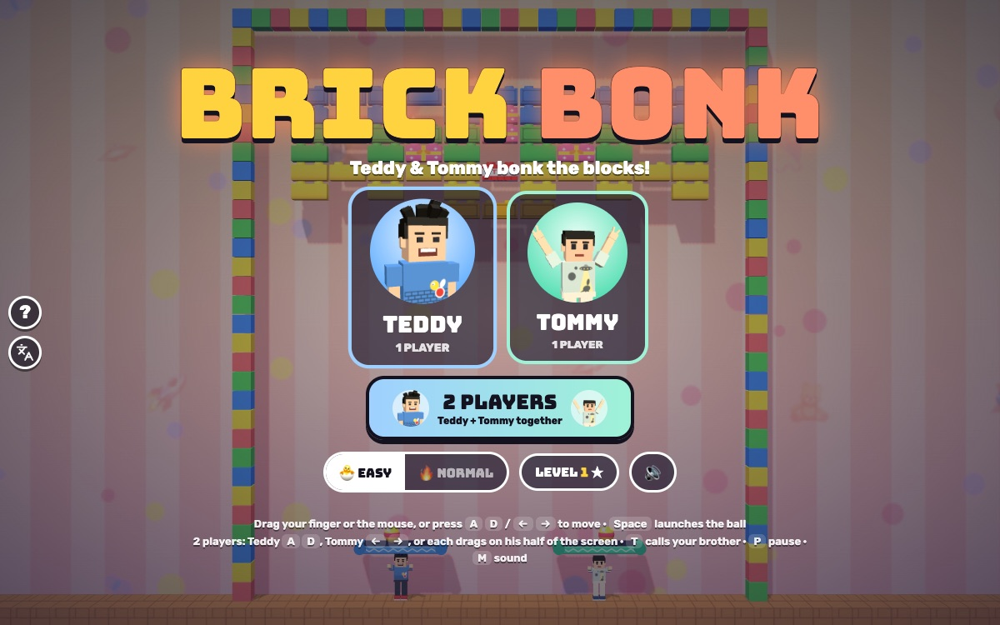

# Brick Bonk

[](https://adong.github.io/brick-bonk/)

Press **?** any time (or tap the round **?** button on the left edge) to see the keys. The game waits while you look.
Tap the language button under it (the A文 icon) to switch between English and 中文; the dashboard and every game remember the choice.

**中文：** 打砖块！Teddy 和 Tommy 把蹦床举过头顶，把球弹上去撞掉所有积木。18 关，单人或双人。

## Play

A brick-breaker starring Teddy and Tommy, built with Claude Code from plain JavaScript and Three.js. Your brother
carries a springy trampoline over his head; bounce the ball on it and bonk every toy block. There are no image,
model or audio files: the kids are the shared kit's blocky characters, every texture is painted on a canvas, and
every sound is synthesised.

- **Double-click `index.html`.** It works offline because Three.js and the kit are copied into `kit/`.
- **Send one file:** `dist/brick-bonk.html` is the whole game in one page (about 830 KB). Rebuild it after any edit:
  `python3 kit/tools/bundle.py . --name brick-bonk`
- The two fonts load from Google Fonts when online. Offline, the game falls back to Arial Black and the system font.
- The name lives in one constant, `BB.TITLE` in `js/title.js` (and the page `<title>` in `index.html`).
- **Pick a brother** (1 PLAYER) or **2 PLAYERS**, 🐣 EASY (the default) or 🔥 NORMAL, and a level (the LEVEL button
  shows the level picker, with your stars). Behind the title the brothers play a level by themselves.
- **The blocks:** coloured toy blocks break with one bonk. Shiny ones (with a frame) need two, gold ones three, and
  they crack as you go. Grey **steel** never breaks. Red **TNT** pops every block around it, and TNT next to TNT goes
  off a moment later, so a row of it goes BOOM BOOM BOOM. Pink **presents** drop a power-up.
- **The bounce:** where the ball lands on the trampoline sets where it goes: the middle sends it straight up, the
  ends send it off at up to 60 degrees.
- **18 levels in three worlds** (Toy Room, Garden, Outer Space), all hand-made, including picture levels: a big heart,
  a smiley, a rocket, a flower, Tommy's flying saucer and dinosaur, a ringed planet and a big **TT** (Teddy's T in
  blue, Tommy's in mint). Each level has a name and a tip that show before it starts.
- **Stars:** 3 for a level with at most one miss, 2 for up to three, 1 for the rest. A miss is losing the last ball,
  or the bubble net catching it. Clearing a level shows the stars, your score and your best, and the brother does his
  signature move with confetti: Teddy's Tyson-style boxing and his 🏀 jump shot, Tommy's Y pose with peace fingers.
  NEXT LEVEL carries on with your score and hearts.
- **🐣 EASY** (for Tommy, 5): a slower ball and a wider trampoline, 5 hearts, and a **bubble net** that saves the
  first 3 misses on every level. After 20 seconds without hitting a block, the ball curves gently toward the nearest
  block it can see ("THE BALL IS HELPING!").
- **🔥 NORMAL** (for Teddy, 8): the classic rules. 3 hearts, no nets, and the ball speeds up as you play.
- **2 players** play together: two trampolines side by side (each can go anywhere along the bottom, even past the
  other), one ball each to start, shared hearts and one team score.
- **Out of hearts:** "OH NO!" and **KEEP GOING!** gives you full hearts right where you are; the blocks you broke stay
  broken. **↻ START LEVEL AGAIN** (in the pause menu) starts it fresh.
- **Never a dull loop:** a bounce never leaves flatter than 15 degrees; a ball that goes straight up and down twice
  gets a little nudge sideways; 10 seconds without a block gives a small nudge, and after 15 seconds the next bounce
  off the trampoline heads for a block the ball can see.

### How it's checked

All the rules live in `js/sim.js` (no Three.js), so `node tools/check.js` plays the real game headlessly in about 5 s,
and `game.check()` runs the same checks in the page. Every part also runs a sabotaged version that must fail:

| check | what passes | the sabotage that must fail |
|---|---|---|
| levels | 18 maps, every row 13 blocks, something to break | |
| autopilot | clears every level on EASY, 1 player with three seeds and 2 players (72 runs), each within 300 s (the slowest takes just under 250 s) | an autopilot that never moves clears nothing |
| tunnelling | at top speed (24) and twice that (48), with BIG BALL and MULTI-BALL mixed in: not one piece of a ball's path overlaps a block still standing or a wall (about 250,000 pieces checked) | a mover without the swept test (move, then look for overlaps) is caught hundreds of times |
| loops | the dullest player (always catches the ball dead centre) on NORMAL: never 2 straight-up bounces in a row, no flat bounces, never more than 30 s without a block; a nearly flat launch is fixed at the first bounce | with the nudges and the 15-degree rule off: 100+ straight-up bounces in a row, 130 s without a block, flat bounces |
| frame rate | the same launch at 30, 60 and 120 frames a second ends at the same step with the same score, blocks and hearts (standing still, and with the autopilot for 60 s) | stepping by the frame time instead gives different endings |

How the physics avoids tunnelling: the rules always step by 1/120 s (`BB.Runner` keeps the leftover time for the next
frame), and each step the ball finds the first thing it would touch along its path (a wall, a block's face or
corner, a trampoline, a net, the floor), stops there, bounces, and carries on with the time that's left. Faces
between two blocks don't count, so a row of blocks is one flat surface.

Test hooks for the browser (the Browser pane throttles animation when hidden, so tests drive the game themselves):
`game.start(level, '1p' | '2p', hero, easy)`, `game.step(seconds)` (ticks and draws), `game.drag('teddy', x)` /
`game.launch()`, `game.press('Space')`, `game.call()`, `game.autopilot()`, `game.peek(x, y, zoom)` (close-up camera),
`game.check()` and `game.state()`. `index.html?level=8&mode=2p` (or `&hero=tommy&easy=0`) opens a level directly.

## Power-ups

Pink presents drop a capsule. Catch it with the trampoline:

| capsule | what it does |
|---|---|
| ↔️ WIDE | the trampoline grows by half, for 15 s |
| ✨ MULTI-BALL (x3) | two more balls split off the one in play |
| 🐢 SLOW BALL | every ball slows down, for 12 s |
| 🍯 STICKY | the ball sticks to the trampoline; tap or Space to let go (it lets go by itself after 2.5 s), for 15 s |
| 🫧 BUBBLE NET | a bubble floor under the trampoline that saves the ball once |
| 💥 BIG BALL | a big fiery ball that smashes straight through blocks (even tough ones; steel still bounces it), for 10 s |

The ones that are on show at the top with a bar running down.

## Controls

| | Keys | Mouse / touch |
|---|---|---|
| **1 player** | A D or ← →, Space (or W / ↑) launches | drag anywhere: the trampoline follows sideways and stays just above your finger; lift your finger (or click) to launch |
| **2 players**: Teddy | A D, W or Space launches | drag on the left half of the screen |
| **2 players**: Tommy | ← →, ↑ or Space launches | drag on the right half of the screen |
| call your brother (1 player) / high five (2 players) | T or Enter | the round face button, top right |
| pause / sound | P or Esc / M | ❚❚ / 🔊 at the top |

On a touch screen a faint strip along the bottom ("← DRAG HERE →") is where your finger goes, and the field sits right
on top of it, beside the kit's round buttons on the left edge, never under them. In 2 players each finger drags its
own trampoline a little faster than the finger moves, so half the screen reaches all the way across.
On the title screen: Enter starts one player as the brother you picked last (← → to switch), 2 starts two players,
E switches easy mode.

## Companion

In 1 player, call the other brother any time with **T** (or Enter, or his face button, top right), as often as you
like:

- He pops in beside your trampoline at his buddy size (Tommy is smaller than Teddy) and does his signature move.
- He tosses you a treat (🍦 💧 🧃 🍪 🍉 🍌, +100) and you hear about it ("🍦 ICE CREAM FROM TOMMY!").
- He launches an extra ball ("TOMMY SAYS: EXTRA BALL!") and holds a bubble net under the trampoline for 10 s: every
  ball that falls bounces back up. A bar under his button shows the time left.
- Call again while he's there for another treat, another ball and another 10 s. Then he waves bye.

In 2 players both brothers are already playing, so the button is a **HIGH FIVE**: both do their signature moves, a
✋ and confetti, and the same extra ball and 10-second bubble net (then 20 s to wait, shown on the button).

## Files

```
index.html       page, HUD, screens (CSS inline)
js/title.js      the game's name (one constant)
js/sim.js        the rules: swept ball physics, trampolines, blocks, TNT, power-ups, nets, lives and stars, the
                 companion and the high five, the autopilot (BB.Bot) and the fixed-step runner (BB.Runner); no
                 Three.js, so it also runs in Node
js/levels.js     the 18 levels (ASCII maps), their names and tips, the three worlds
js/checks.js     the headless checks and their sabotaged versions (node tools/check.js, game.check())
js/art.js        canvas-painted textures: backdrops, floors, block faces, cracks, ball, trampoline, net, capsules
js/view.js       the Three.js scene: the level, the blocks (instanced), balls, trampolines, kids, buddy, effects
js/poses.js      extra poses on top of Kit.people.pose (carry, oops, cheer, hold)
js/sfx.js        sounds made with Kit.sound.tone / hiss (boing, tok on a rising scale, clang, boom, ...)
js/game.js       screens, keyboard, mouse and touch, HUD, companion button, toasts, saving, title demo, test hooks
js/keys.js       the keys the ? panel shows (Kit.help)
js/zh.js         中文: every word on the page, the level names and tips, the canvas words, the ? panel (Kit.lang)
tools/check.js   the headless check (node tools/check.js [--quick])
kit/             copy of ~/claude-games/kit (python3 ../kit/tools/sync.py .); don't edit it here
docs/            the screenshot
dist/brick-bonk.html   the single-page build
```

## Not verified

- **Sound:** every effect goes through `Kit.sound` and follows the kit's one sound switch, but nobody listened: all
  testing was muted.
- **Real touch devices:** dragging was tested with simulated pointer events at iPad (1024x768) and phone (390x844,
  740x360) sizes in the Browser pane, not with a real finger on a real iPad or phone.
- **Real kids:** the ball speeds, the trampoline sizes, how long a level takes (the autopilot needs 1-4 minutes on
  EASY; a 5-year-old will take longer) and the star rules are guesses until Teddy and Tommy play it.
- **Home-screen icon:** the apple-touch-icon is drawn by script like the other games; not tried on a device.
